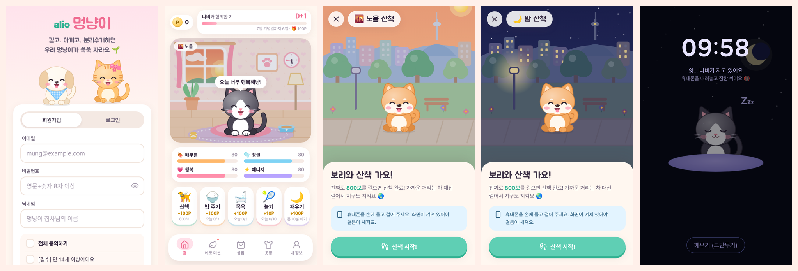
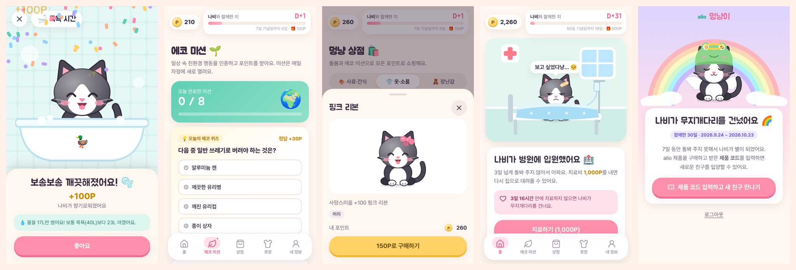
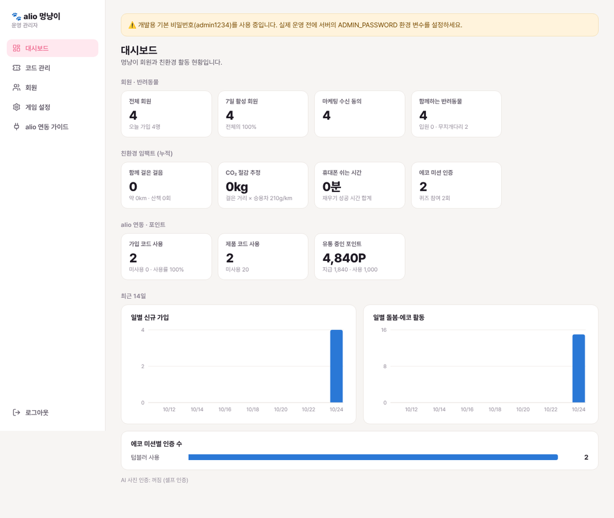

# alio 멍냥이 🐶🐱

**A mobile web game where young Korean users raise a digital dog or cat by doing real eco-friendly things.** Walk 800 real steps to take your pet on a walk, put your phone down for 10 minutes so it can sleep, and snap a photo of your tumbler or your recycling to earn points for food, clothes and toys.

The whole interface is in Korean, mobile-first, and installable to the home screen.




---

## What's in it

| Screen | What happens |
|---|---|
| 회원가입 / 로그인 | Email + password, Korean privacy consents (만 14세 이상, 이용약관, 개인정보, optional marketing) |
| 입양 | Choose 멍멍이 or 냥냥이, pick one of three coats, name your pet. Starter gift: food, a snack, a toy |
| 홈 (house) | Pet in its room. The window shows the **real sky for the phone's local time** (sunrise, day, sunset, night), the wall clock shows the real time, and a lamp switches on after dark. Top bar: **wallet** + **D+day tracker** with the next anniversary reward |
| 산책 | Real steps from the phone's motion sensor (default **800 steps**). The scene switches to a park with Namsan Tower; sky and street lamps follow local time. Shows distance and CO₂ saved |
| 밥 주기 | Feed food or snacks from your bag (each species has favourites) |
| 목욕 | Mini game: rub to lather, rinse, **turn the water off yourself**, towel dry. Reports litres used vs. a 40 L bath |
| 놀아주기 | Throw a toy (or pet by hand) |
| 재우기 | Leave the phone untouched for **10 minutes** (screen stays on, app in front). Opening another app wakes the pet |
| 에코 미션 | Daily eco quiz (30 questions rotating) + 7 photo missions: tumbler, recycling, eco bag, clean plate, public transport, unplugging, plogging |
| 상점 · 옷장 | 9 foods/snacks, 15 wearables (hats, glasses, collars, outfits that fit both species), 8 toys |
| 내 정보 | Wallet, alio code entry, eco report (steps, CO₂, water, phone-free minutes), point history, account settings |
| 병원 | After **3 days** without care the pet is hospitalised; healing costs **1,000P**. Eco missions stay open so the bill can be earned |
| 무지개다리 | After **7 days** without care the pet dies. The game is locked until the user enters a **code from a new alio product**, which grants a new adoption |

Care actions and rewards (all editable in the admin dashboard):

| Action | Reward | Real-world requirement | Daily limit |
|---|---|---|---|
| 산책 | 100P | 800 real steps (server rejects walks faster than 3.2 steps/s) | 3 |
| 밥 주기 | 100P | Uses a food item; 2-hour gap | 3 |
| 목욕 | 100P | Bath mini game | 2 |
| 놀아주기 | 10P | Toy mini game | 10 |
| 재우기 | 100P | Phone untouched for 10 min (browser heartbeat checked on the server) | 2 |
| 에코 퀴즈 | 30P | Correct answer | 1 |
| 사진 미션 | 50P (플로깅 100P) | Photo proof, optionally checked by AI | 1 each |
| alio 가입 코드 | 500P | 5-digit code from alio's website | once per account |
| 기념일 | 100–3,000P | D+7, 30, 50, 100, 200, 365 | — |

---

## How the alio codes work automatically

**Sign-up bonus (500P).** When someone finishes signing up on alio's website, alio's server makes one HTTPS call to 멍냥이 and gets back a unique 5-digit code plus a link (`https://<game>/?code=48213`). alio shows that code on the welcome page and in the welcome email. The member types the code into 멍냥이, or taps the link and the code is filled in for them, and receives 500P. Each code works once, each account can claim the bonus once, and calling again for the same member returns the same code, so retries never hand out duplicates.

**New product → new pet.** The same API issues 8-character product codes (`7KQM-3XTP`) when an order is paid. For boxed products, alio staff can also generate thousands of codes in the admin dashboard and download a CSV to print on cards.

**No developer at alio?** Codes can also be generated in bulk in the admin dashboard and sent with an email tool's "unique coupon code" feature, or wired up with a no-code automation tool (sign-up → HTTP request → email).

The full developer guide, in Korean, is in **[docs/INTEGRATION.ko.md](docs/INTEGRATION.ko.md)**. The admin page also shows it with the real server address and API key filled in.

Brute-force protection: 5 wrong codes per account per 30 minutes, 20 per IP per hour, outstanding sign-up codes capped at 20,000, and an optional email binding (`email` field) so a code only works for the matching account.

---

## Admin dashboard (`/admin`)



- **대시보드**: members, active users, pets (healthy / hospital / rainbow bridge), total steps, estimated CO₂ saved, phone-free minutes, mission counts, code usage, points in circulation, 14-day charts. Useful for ESG reporting.
- **코드 관리**: generate code batches with a memo, filter and search, revoke, CSV export.
- **회원**: search members, view their pet and history, adjust points, grant an adoption ticket, issue a temporary password (customer support).
- **게임 설정**: every reward, limit, step goal, sleep minutes, hospital/death days, heal cost, alio links and support email. Changes apply immediately without a redeploy. Includes a **시연 모드** (demo mode) that adds "finish now" buttons to walks and sleep for presentations on a laptop.
- **alio 연동 가이드**: the API key (reveal, copy, rotate) and copy-paste examples.

---

## Running it

Requires **Node.js 20.19+** (22 LTS recommended).

```bash
npm install
npm run build          # builds the game and admin front end into dist/
ADMIN_PASSWORD=choose-one npm start
# → http://localhost:3000 (game) and http://localhost:3000/admin
```

Development, with hot reload (http://localhost:5173, admin at http://localhost:5173/admin.html, dev admin password `admin1234`):

```bash
npm run dev
```

Tests (game rules, codes, hospital/death, security):

```bash
npm test
```

### Configuration

| Variable | Required | Purpose |
|---|---|---|
| `ADMIN_PASSWORD` | **yes** in production | Password for `/admin` |
| `PUBLIC_URL` | recommended | Public address of the game, used in links returned to alio (e.g. `https://pet.example.com`) |
| `DATA_DIR` | recommended | Folder for the SQLite database. Put it on a persistent disk |
| `PORT` | no | Default 3000 |
| `PARTNER_API_KEY` | no | Fixed API key for alio's website. If unset, one is generated and shown in the admin page |
| `ANTHROPIC_API_KEY` | no | Turns on AI checking of eco-mission photos. Without it, photo missions are self-reported (one per mission per day, duplicate photos rejected) |
| `TRUST_PROXY` | no | Proxy hops to trust for client IPs (default 1 in production) |
| `COOKIE_SECURE` | no | Secure cookies, default on in production |

See `.env.example`.

### Deploying

The app is one Node process with an embedded SQLite database, so it runs on any host with a persistent disk: Render, Fly.io, Railway, AWS Lightsail, NCP, or a plain VPS.

```bash
docker build -t alio-mungnyang .
docker run -d -p 3000:3000 -v mungnyang-data:/data \
  -e ADMIN_PASSWORD=... -e PUBLIC_URL=https://pet.example.com alio-mungnyang
```

**HTTPS is required.** Phones only expose the motion sensor (step counting), the screen wake lock (sleep) and the camera to secure pages. Every host above provides HTTPS; on a VPS, put Caddy or nginx with Let's Encrypt in front.

**Back up the database.** Everything lives in `DATA_DIR/mungnyang.db`. Snapshot the disk daily, or use a tool like Litestream to stream it to object storage.

---

## Before launch

- [ ] Set `ADMIN_PASSWORD`, `PUBLIC_URL`, and a persistent `DATA_DIR`; serve over HTTPS
- [ ] In 게임 설정, fill in the alio sign-up page URL, store URL and support email (the related buttons stay hidden until set)
- [ ] Have legal counsel review the terms and privacy text in `web/src/legal.js` (company details, contact, effective date). If AI photo checks are on, the privacy text already discloses that photos go to Anthropic (US) for checking and are not stored
- [ ] Give alio's web developer `docs/INTEGRATION.ko.md` and the API key
- [ ] Decide whether to enable AI photo checks (`ANTHROPIC_API_KEY`)
- [ ] Make sure **시연 모드** is off

## Known limits

- **Steps are counted only while the page is open and the screen is on.** Browsers can't read the phone's health/step data or run in the background. The walk screen keeps the screen awake and tells the user to hold the phone while walking. A native app wrapper could read HealthKit / Google Fit later.
- **Sleep uses a strict rule.** Locking the phone counts as leaving the app, because browsers can't tell locking apart from switching apps. The screen stays on with a dark display, which costs little power on OLED phones.
- **No push notifications or self-service password reset yet.** Support can issue temporary passwords from the admin page. Both need an email/push provider account.
- The server runs as a single instance (rate limits and admin sessions live in memory). That is plenty for a launch; moving to Postgres and Redis would be the step for multi-server scale.

## Project layout

```
server/            Express API
  game.js          pet stats, care actions, hospital/death rules, wallet
  codes.js         alio sign-up & product codes
  eco.js           eco quiz and photo missions (optional AI check)
  routes/          player API, partner API for alio, admin API
web/               React front end (Vite)
  src/components/  Pet art (SVG), scenes, shared UI
  src/screens/     login, adopt, home, eco, shop, closet, profile, hospital, memorial
  src/modes/       walk, sleep, bath, feed, play
  src/admin/       admin dashboard
tests/             API tests (node --test)
docs/              alio integration guide (Korean), screenshots
```
